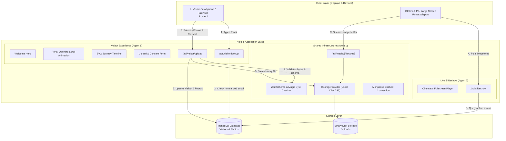
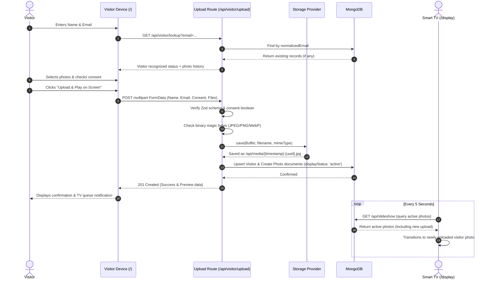

# ARCHITECTURE & SYSTEM DESIGN

## 1. Technology Stack Choice & Rationale

| Layer | Technology | Rationale |
|---|---|---|
| **Full-Stack Framework** | **Next.js 14 (App Router)** | Unified full-stack architecture with React Server Components, high-performance API Route Handlers, automatic code splitting, and zero-configuration SSR. |
| **Language** | **TypeScript** | End-to-end type safety across shared database models, API payloads, form schemas, and UI components. Eliminates runtime contract mismatches between Agent 1, Agent 2, and Agent 3. |
| **Database** | **MongoDB & Mongoose** | Flexible document model ideally suited for visitor profiles, polymorphic photo metadata, and relationship linking with fast query indexing. |
| **Styling & Design Tokens** | **Tailwind CSS** | Utility-first styling with custom record-label theme tokens (`#0A0C0E` background, `#EDE7DC` primary text, `#E8913C` amber, `#2E6B72` teal, and hairline borders). |
| **Animations** | **Framer Motion** | Physics-based animations, scroll progress hooks (`useScroll`), reversible viewport portal opening, and dynamic SVG `pathLength` drawing. |
| **File Validation** | **Zod & Binary Magic Bytes** | Multi-tier defense validating input structure via Zod and inspecting binary file headers to block disguised executables and malicious files. |
| **Storage Abstraction** | **LocalStorageProvider (`IStorageProvider`)** | Modular storage interface serving files via controlled media routes with long-term HTTP cache headers. |

---

## 2. System Architecture Diagram



---

## 3. Data Model

### A. Visitor Entity (`visitors` collection)
```typescript
{
  _id: ObjectId,
  name: string,             // Full name
  email: string,            // Raw email address
  normalizedEmail: string,  // Lowercase trimmed email [UNIQUE INDEX]
  createdAt: Date,          // Initial visit date
  lastVisitAt: Date         // Most recent visit date
}
```

### B. Photo Entity (`photos` collection)
```typescript
{
  _id: ObjectId,
  visitorId: ObjectId,      // Reference to Visitor [INDEXED]
  imageUrl: string,         // Stream URL: "/api/media/<filename>"
  originalName: string,     // Original filename
  mimeType: string,         // Detected MIME type ("image/jpeg", "image/png", "image/webp")
  size: number,             // File size in bytes
  consentGiven: boolean,    // Explicit consent agreement
  consentTimestamp: Date,   // Immutable timestamp of consent
  uploadedAt: Date,         // Upload timestamp [INDEXED]
  displayStatus: string     // "active" | "archived" | "flagged" [INDEXED]
}
```

---

## 4. Sequence Diagram: Visitor Upload & Smart Display Sync


